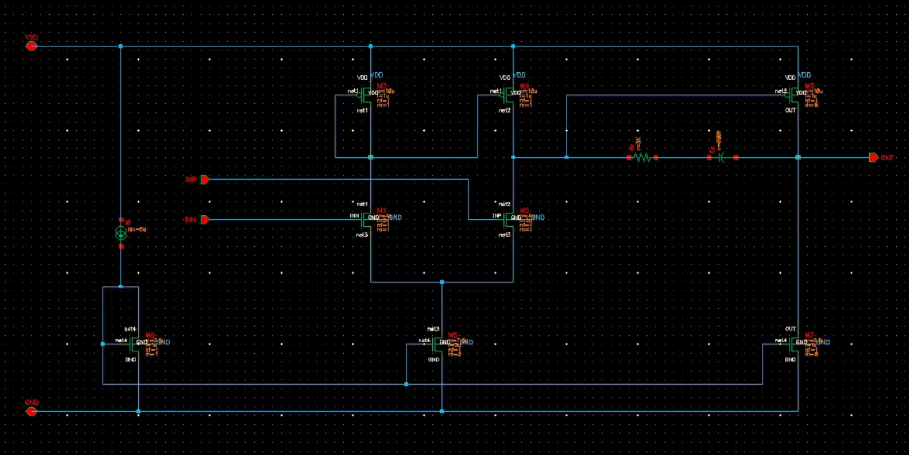
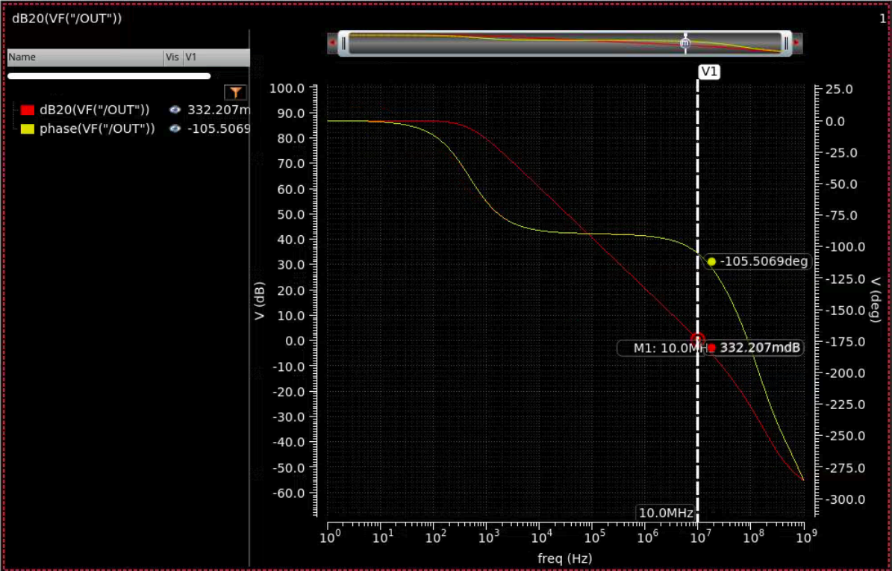
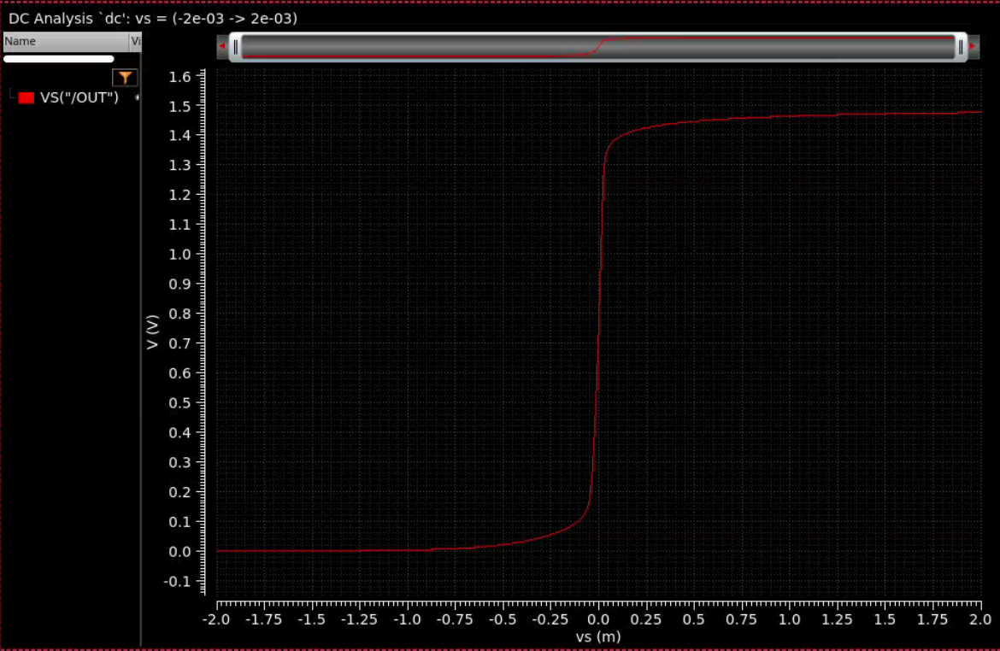
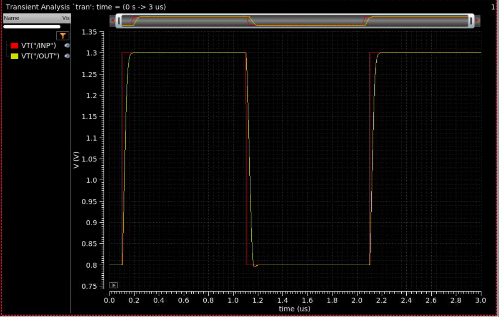
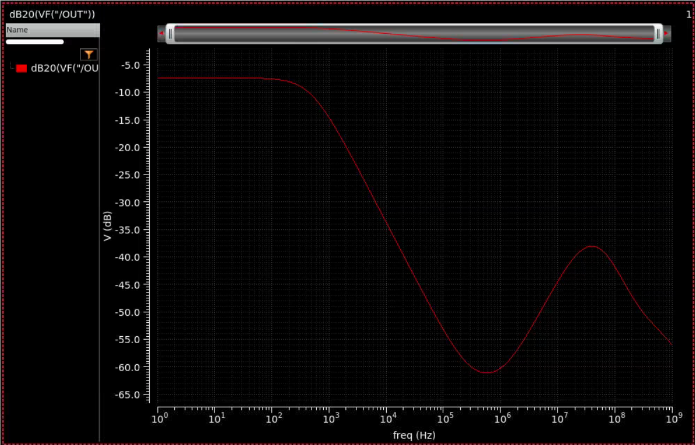
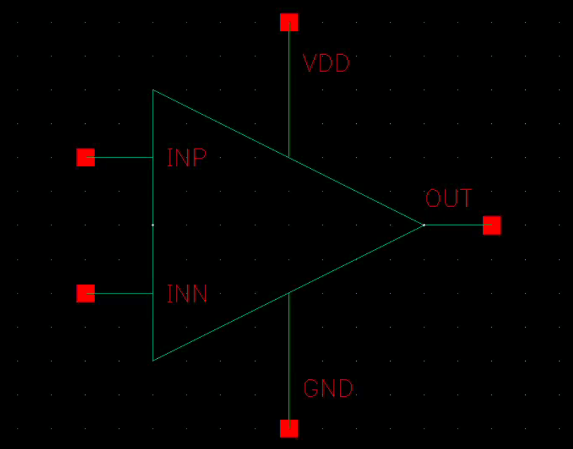
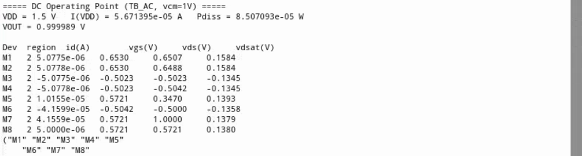

# 🔺 MillerCore — Low-Power Two-Stage CMOS Op-Amp (IBM 130 nm, Cadence Virtuoso + Spectre)

> **87 dB gain, 10.4 MHz GBW and 74° phase margin on a single 1.5 V supply, using just 85 µW.**

A **two-stage Miller-compensated CMOS operational amplifier** designed in the **IBM 0.13 µm cmrf8sf** process. It runs from a **single 1.5 V supply (no negative rail)**, is biased by **one 5 µA ideal current source**, and drives a **2 pF load**. Hand calculations set the starting sizes, which were then tuned in **Cadence Virtuoso** with **Spectre** until all transistors sat in saturation and every specification was met with margin.

<p align="center"></p>

## Performance

| Specification | Target | Achieved |
|---|---|---|
| Differential gain, Avd | ≥ 70 dB | **86.84 dB** |
| Unity-gain bandwidth, GBW | ≥ 6 MHz | **10.40 MHz** |
| Phase margin, PM | ≥ 60° | **73.96°** |
| Output voltage swing, OVSR | ≥ 1.20 V | **1.476 V** |
| Average slew rate, SR | ≥ 4 V/µs | **10.18 V/µs** |
| Common-mode gain, CMG | ≤ 5 dB | **−7.40 dB** (CMRR ≈ 94.2 dB) |
| Power dissipation (VDD = 1.5 V) | ≤ 0.1 mW | **85.07 µW** |
| Load / supply / ideal sources | 2 pF / 1.5 V / 1 | 2 pF / 1.5 V / 1 (5 µA) |

## Architecture

- **Stage 1:** NMOS differential pair **M1/M2** with a PMOS current-mirror load **M3/M4**, converting the differential input to a single-ended signal at node X.
- **Stage 2:** PMOS common-source amplifier **M6** with NMOS current-sink load **M7** for the second gain stage and the 2 pF drive.
- **Compensation:** Miller capacitor **Cc = 0.8 pF** in series with nulling resistor **Rz = 5 kΩ**, which sets the dominant pole and moves the right-half-plane zero for better phase margin.
- **Bias:** a single ideal **I0 = 5 µA** into diode-connected **M8**, mirrored to the tail **M5 (10 µA)** and the output sink **M7 (≈ 41.6 µA)**.

## Device Sizing (all devices in saturation)

| Device | Type | W (µm) | L (µm) | m | I_D (µA) | V_GS (V) | V_DS (V) | V_dsat (V) |
|---|---|---|---|---|---|---|---|---|
| M1, M2 | nfet33 | 4 | 2 | 1 | 5.08 | 0.653 | 0.65 | 0.158 |
| M3, M4 | pfet33 | 10 | 1 | 1 | −5.08 | −0.502 | −0.50 | −0.135 |
| M5 | nfet33 | 7.5 | 3 | 2 | 10.16 | 0.572 | 0.347 | 0.139 |
| M6 | pfet33 | 10 | 1 | 8 | −41.60 | −0.504 | −0.500 | −0.136 |
| M7 | nfet33 | 2.5 | 1 | 8 | 41.60 | 0.572 | 1.000 | 0.138 |
| M8 | nfet33 | 2.5 | 1 | 1 | 5.00 | 0.572 | 0.572 | 0.138 |

**Design choices**
- **Power budget first:** 0.1 mW from 1.5 V allows only 66.7 µA, so the total is 5 + 10.16 + 41.6 ≈ 56.7 µA.
- **Zero systematic offset:** (W/L)₆/(W/L)₄ = 2·(W/L)₇/(W/L)₅, which gives 8 = 2·(20/5).
- **High gain:** 1–3 µm channel lengths instead of minimum raise r_o, giving Avd ≈ 87 dB.
- **Low CMG:** the tail device M5 uses L = 3 µm to raise its output resistance.
- **Wide swing:** V_dsat6 ≈ V_dsat7 ≈ 0.14 V, so the output reaches within about 0.14 V of each rail.

**First-order hand analysis**

```
GBW ≈ gm1 / (2π·Cc)          →  gm1 ≈ 2π × 10.4 MHz × 0.8 pF ≈ 52 µS
SR+ ≈ I5 / Cc                 =  10.16 µA / 0.8 pF ≈ 12.7 V/µs   (simulated 10.18 V/µs: node-X parasitics add to Cc)
Avd = gm1(ro2 ∥ ro4) · gm6(ro6 ∥ ro7)
Pdiss = VDD · (I0 + I5 + I7) = 1.5 V × 56.7 µA ≈ 85 µW
```

## Verification Testbenches

| Testbench | Measures | Method |
|---|---|---|
| **TB_AC** | Avd, GBW, PM | 1 GH inductor OUT→INN closes the loop at DC (sets the operating point, cancels offset); 1 F cap grounds INN for AC, so the loop is open. AC sweep 1 Hz – 1 GHz. |
| **TB_CM** | Common-mode gain | Same as TB_AC, but the 1 F cap ties INN to INP, so both inputs see the same AC signal. |
| **TB_SWING** | Output swing | VCVS sources drive INP/INN = CM ± vs/2; DC sweep of vs from −2 mV to +2 mV, open loop. |
| **TB_SR** | Slew rate | Unity-gain buffer, 0.8 V ↔ 1.3 V pulse (1 ns edges); 10–90 % slope of V(OUT). |

### Results

| Open-loop gain & phase (TB_AC) | DC transfer / output swing (TB_SWING) |
|---|---|
|  |  |

| Large-signal step response (TB_SR) | Common-mode gain (TB_CM) |
|---|---|
|  |  |

- **AC:** 86.84 dB DC gain, unity-gain crossing at 10.40 MHz, 73.96° phase margin.
- **Swing:** rail-to-rail-like transfer curve; the high-gain region alone spans ≈ 0.1 V – 1.4 V.
- **Slew:** SR+ = 10.35 V/µs, SR− = 10.00 V/µs, no ringing (consistent with 74° PM).
- **CMG:** −7.40 dB at low frequency, so CMRR ≈ 94.2 dB.

| Symbol | DC operating point |
|---|---|
|  |  |

## Repository Structure

```
├── netlists/
│   ├── amplifier.scs        # op-amp subcircuit (human-readable Spectre netlist)
│   ├── tb_ac.scs            # gain / GBW / phase-margin testbench
│   ├── tb_cm.scs            # common-mode gain testbench
│   ├── tb_swing.scs         # output-swing DC sweep testbench
│   └── tb_sr.scs            # slew-rate transient testbench
├── cadence/
│   ├── EE6326_PROJECT/      # Virtuoso library: AMPLIFIER (schematic + symbol), TB_AC/CM/SWING/SR
│   └── cds.lib.example      # library definitions to open the design
└── images/                  # schematic, testbenches and simulation plots
```

## How to Use

**Run the netlists directly with Spectre** (requires access to the IBM cmrf8sf PDK):

1. Edit the two `include` lines at the top of each `netlists/tb_*.scs` to point at your PDK's `Spectre/models/` folder.
2. Run, for example:
   ```bash
   spectre netlists/tb_ac.scs
   ```
3. View the results in ViVA or another PSF viewer: `dB20(VF("/OUT"))`, `unityGainFreq`, `phaseMargin`.

**Open in Cadence Virtuoso:**

1. Copy `cadence/cds.lib.example` to `cadence/cds.lib` and set `<PDK_ROOT>`.
2. Launch `virtuoso` from `cadence/`, open the `EE6326_PROJECT` library, and run the testbenches from ADE L / ADE Explorer.

> The IBM PDK (device models, DRC/LVS rule decks) is foundry-licensed and is **not** included; only the original design files are.

## Tools

Cadence Virtuoso IC6 · Spectre · ADE L · IBM 0.13 µm cmrf8sf PDK (V1.8.0.4DM)

## Reference

B. Razavi, *Design of Analog CMOS Integrated Circuits*, 2nd ed., McGraw-Hill, 2017.

## Author

- **Aryan Verma**
